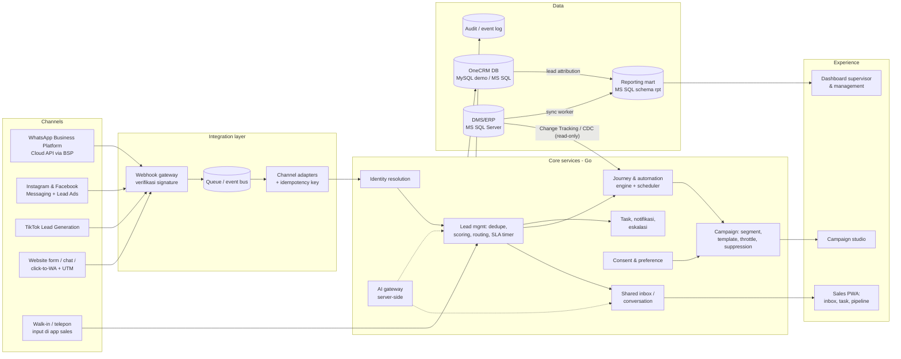

# Hasjrat OneCRM

**Mengubah WhatsApp dari sekadar communication channel menjadi customer management platform yang terintegrasi**

*One Customer · One Journey · Every Channel*

| | |
|---|---|
| Kandidat | Putra Irawan |
| Posisi | Senior Business System Analyst & Digitalization |
| Untuk | Kepala Divisi IT, PT Hasjrat Abadi |
| Tanggal | Oktober 2026 |
| Lampiran | Prototype interaktif (Next.js + Go + MySQL + MS SQL Server), source code, deck presentasi |

> **Catatan kejujuran.** Dokumen ini adalah usulan konsep untuk keperluan assessment, bukan produk resmi PT Hasjrat Abadi. Prototype memakai data sintetis (nama customer, cabang, produk, nilai, dan aktivitas fiktif). Angka di luar skenario (10.000 inquiry, 30%, 20%) adalah **asumsi untuk divalidasi** saat discovery, bukan klaim tentang kondisi aktual perusahaan.

---

## Daftar isi

1. [Ringkasan eksekutif](#1-ringkasan-eksekutif)
2. [TASK 1 – Problem Diagnosis](#2-task-1--problem-diagnosis)
3. [TASK 2 – Design Customer Journey](#3-task-2--design-customer-journey)
4. [TASK 3 – High-Level System Architecture & System Automation](#4-task-3--high-level-system-architecture--system-automation)
5. [Dashboard Penjualan & integrasi MS SQL Server](#5-dashboard-penjualan--integrasi-ms-sql-server)
6. [Penggunaan AI](#6-penggunaan-ai)
7. [Roadmap 12 minggu, KPI, risiko, dan tim](#7-roadmap-12-minggu-kpi-risiko-dan-tim)
8. [Panduan demo prototype](#8-panduan-demo-prototype)

---

## 1. Ringkasan eksekutif

### Permintaan management

> "Mengubah WhatsApp dari sekadar communication channel menjadi customer management platform yang terintegrasi."

### Jawaban dalam satu kalimat

Jadikan **customer** (bukan nomor HP sales, bukan chat) sebagai pusat data: setiap inquiry dari WhatsApp, website, Instagram, Facebook, TikTok, maupun walk-in masuk ke **satu profil customer** di OneCRM, diproses lewat **satu journey standar** dengan SLA dan otomasi, disinkronkan dengan status penjualan di **DMS/ERP MS SQL Server**, dan dipantau lewat **dashboard real-time** — dengan AI sebagai asisten sales, bukan pengganti.

### Tiga pilar solusi

| Pilar | Apa yang berubah | Masalah yang diselesaikan |
|---|---|---|
| **One Customer** | Nomor WhatsApp Business milik perusahaan, shared inbox, identity resolution lintas channel, consent tersimpan | Data di HP pribadi, customer mengulang informasi, tidak ada histori |
| **One Journey** | Stage standar dari inquiry → SPK → DO → aftersales, routing otomatis, SLA 15 menit dengan eskalasi, cadence follow-up | 30% inquiry terlambat, tidak ada standar follow-up |
| **Every Channel, One Truth** | Integrasi event-driven dengan DMS/ERP MS SQL, suppression otomatis, reporting mart `rpt` untuk dashboard | Management buta status prospect, pembeli tetap menerima prospecting, broadcast manual |

### Target outcome pilot (baseline diukur saat discovery)

| KPI | Baseline (dari skenario / diukur) | Target pilot 12 minggu |
|---|---|---|
| Inquiry yang mendapat respons manusia ≤15 menit (jam kerja) | ±70% (30% terlambat) | **≥90%** |
| Customer yang harus mengulang informasi saat pindah channel/sales | ±20% | **<5%** |
| Lead yang tercatat di CRM (bukan hanya di HP pribadi) | Belum terukur | **100%**, 0 lead hanya di HP pribadi |
| Pembeli (SPK/DO) yang masih menerima pesan prospecting | Terjadi | **0** (diblok otomatis saat kirim) |
| Freshness dashboard status prospect & penjualan | Tidak ada / manual | **≤15 menit** |
| Konversi lead → SPK | Diukur saat discovery | **Naik** vs baseline (target angka ditetapkan setelah baseline) |
| Broadcast manual | Manual | **100% melalui campaign tool** dengan template disetujui, consent, dan frequency cap |

---

## 2. TASK 1 – Problem Diagnosis

### 2.1 Framing masalah

WhatsApp saat ini dipakai sebagai **alat chat pribadi**, bukan sebagai **sistem**. Akibatnya tidak ada pemilik data, tidak ada proses yang bisa diukur, dan tidak ada sambungan antara percakapan dengan status penjualan. Ketujuh gejala dalam skenario bukan tujuh masalah terpisah — mereka muncul dari enam akar masalah yang sama.

### 2.2 Gejala → akar masalah → dampak → solusi

| # | Gejala (skenario) | Akar masalah | Dampak bisnis | Solusi OneCRM |
|---|---|---|---|---|
| 1 | 30% inquiry tidak di-follow-up tepat waktu (±3.000/bulan) | Tidak ada routing, SLA timer, dan eskalasi; inquiry menumpuk di HP individu; di luar jam kerja tidak ada penanganan | Prospek pindah ke dealer pesaing; konversi turun | Auto-acknowledgement <1 menit, routing otomatis per cabang/produk/kapasitas, SLA 15 menit dengan warning menit ke-10 dan eskalasi ke supervisor, bot kualifikasi after-hours |
| 2 | 20% customer mengulang informasi saat pindah channel (±2.000/bulan) | Identitas terfragmentasi per channel; tidak ada profil tunggal dan histori percakapan bersama | Pengalaman buruk, waktu sales terbuang, data kebutuhan hilang | Identity resolution (E.164, email, social ID → golden customer ID), timeline lintas channel, ringkasan percakapan otomatis saat handover |
| 3 | Management tidak bisa melihat status real-time seluruh prospect | Tidak ada system of record dan definisi stage; data tersebar di chat | Forecast dan alokasi sumber daya berbasis asumsi | Pipeline stage standar, event audit, dashboard CRM + dashboard penjualan dari MS SQL dengan label freshness |
| 4 | Sebagian sales menyimpan customer hanya di HP pribadi | Nomor/akun WA milik pribadi; tidak ada kebijakan ownership data | Pipeline hilang saat sales resign/mutasi; risiko kepatuhan data pribadi | Nomor WhatsApp Business Platform milik perusahaan, shared inbox di aplikasi sales (PWA), bulk reassign saat resign/mutasi |
| 5 | Tidak ada standard follow-up journey | Tidak ada playbook, stage, dan cadence; kualitas bergantung individu | Kinerja tidak konsisten antar cabang; sulit coaching | Journey standar 9 tahap + cadence H+0/H+1/H+3/H+7/H+14 + nurture, task otomatis, template disetujui |
| 6 | Broadcast marketing dilakukan secara manual | Tidak ada campaign tool, segmentasi, consent, dan throttling | Biaya tinggi, risiko nomor WA turun quality rating/diblokir, sulit diukur | Campaign studio: segmen dari data CRM, template disetujui, consent check, frequency cap, pengukuran hasil |
| 7 | Customer yang sudah membeli masih menerima prospecting | Marketing tidak terhubung ke status penjualan (SPK/DO) di DMS/ERP | Customer merasa tidak dikenal; brand terkesan tidak profesional; opt-out meningkat | Event `erp.spk.created`/`erp.do.delivered` dari MS SQL → stage Order/Won → suppression otomatis, dicek ulang saat kirim (send-time check) |

### 2.3 Enam tema akar masalah

| Tema | Akar masalah | Kategori |
|---|---|---|
| A | **Tidak ada system of record dan ownership data** — customer "milik" sales, bukan perusahaan | Governance, Technology |
| B | **Tidak ada proses lead management** — routing, SLA, eskalasi, kapasitas | Process, People |
| C | **Identitas customer terfragmentasi** — tiap channel dan tiap HP adalah silo | Data, Technology |
| D | **Tidak ada journey standar** — stage, cadence, dan exit criteria tidak didefinisikan | Process |
| E | **Marketing tidak terhubung ke status penjualan dan consent** — tidak ada suppression | Process, Data, Governance |
| F | **Tidak ada lapisan KPI** — tidak ada definisi metrik dan data yang segar | Data |

### 2.4 Estimasi dampak (formula transparan)

Semua angka di bawah ini kecuali 10.000 / 30% / 20% adalah **asumsi untuk divalidasi**. Tujuannya menunjukkan cara menghitung, bukan klaim angka aktual.

| Langkah | Formula | Hasil ilustratif |
|---|---|---|
| Inquiry WhatsApp per bulan | dari skenario | 10.000 |
| Lead unik | 10.000 ÷ 2,5 inquiry per lead *(asumsi)* | ±4.000 lead |
| Lead yang terlambat di-follow-up | 30% × 4.000 | ±1.200 lead |
| Selisih konversi lead → SPK | 5,0% tepat waktu vs 2,5% terlambat *(asumsi)* | 2,5 poin persen |
| SPK yang hilang per bulan | 1.200 × 2,5% | **±30 SPK/bulan** |
| Nilai penjualan yang hilang | 30 × rata-rata nilai unit Rp130 juta *(asumsi bauran mobil & motor)* | **±Rp3,9 miliar/bulan** (nilai penjualan, bukan margin) |
| Waktu sales untuk mengulang tanya | 2.000 inquiry × 3 menit *(asumsi)* | ±100 jam kerja sales/bulan |

Cara membaca: setiap kenaikan 1 poin persen respons tepat waktu bernilai kira-kira 40 lead × selisih konversi. Angka final dihitung ulang dengan data baseline dari discovery.

### 2.5 Risiko jika dibiarkan

- **Nomor WhatsApp diblokir atau quality rating turun** akibat broadcast massal tanpa opt-in dan tanpa template yang disetujui (WhatsApp Business Messaging Policy).
- **Kepatuhan UU No. 27 Tahun 2022 tentang Pelindungan Data Pribadi (UU PDP)**: data pribadi customer tersimpan di HP pribadi tanpa kontrol akses, tanpa dasar pemrosesan yang tercatat, dan tanpa mekanisme penghapusan/opt-out.
- **Kehilangan pipeline saat sales resign atau mutasi** karena histori percakapan ikut pergi bersama HP.
- **Keputusan management berbasis asumsi** karena tidak ada data prospect yang segar.

### 2.6 Validasi saat discovery (minggu 1–2)

Diagnosis di atas adalah hipotesis. Sebelum membangun, ukur baseline berikut:

| Hipotesis | Data / metode validasi |
|---|---|
| Keterlambatan terkonsentrasi di jam/cabang tertentu | Sampling ekspor chat WA (dengan izin), distribusi first-response time per jam, hari, cabang, sales |
| Porsi inquiry di luar jam kerja signifikan | Proporsi inquiry 17.00–08.00 dan akhir pekan |
| Pengulangan informasi karena pindah channel/sales | Wawancara 10–15 customer, analisis duplikasi nomor/nama lintas channel |
| Data di HP pribadi | Survei sales + audit jumlah nomor WA yang dipakai untuk jualan |
| Pembeli masih menerima prospecting | Cocokkan daftar broadcast terakhir dengan data SPK/DO di MS SQL |
| Konversi berbeda antara lead cepat vs lambat | Join sampel lead dengan SPK di DMS/ERP (nomor HP/nama) |

### 2.7 Prioritas (impact vs effort)

| | Effort rendah | Effort tinggi |
|---|---|---|
| **Impact tinggi** | **Quick wins:** nomor WA perusahaan + shared inbox, auto-ack, routing & SLA 15 menit, suppression pembeli dari data SPK | **Strategic:** identity resolution lintas channel, integrasi event MS SQL (Change Tracking), dashboard penjualan |
| **Impact sedang** | Template follow-up standar, opt-out keyword | AI (ringkasan, scoring, drafting), channel IG/FB/TikTok penuh |

---

## 3. TASK 2 – Design Customer Journey

### 3.1 Prinsip

1. **Satu profil customer, banyak opportunity.** Customer yang sama dapat memiliki opportunity baru (mis. pembelian kedua) tanpa kehilangan histori.
2. **Customer tidak pernah mengulang informasi.** Setiap handover membawa ringkasan percakapan dan data kualifikasi.
3. **Status penjualan berasal dari sistem sumber.** SPK dan DO dibaca dari DMS/ERP MS SQL, bukan diketik ulang.
4. **Komunikasi mengikuti tahap.** Prospecting berhenti otomatis saat customer membeli, opt-out, atau dinyatakan lost.

### 3.2 Peta journey (dealer otomotif)

```
Awareness → Inquiry & Capture → Kualifikasi → Assignment & Konsultasi → Test drive / Kunjungan
        → Penawaran & Negosiasi → SPK (Order) → DO / Serah terima → Aftersales & Loyalty
Exit paths: Lost (reason code) · Nurture · Opt-out · Purchased (suppress prospecting)
```

| # | Tahap | Tujuan customer | Touchpoint / channel | Otomasi | Owner & SLA | Data yang ditangkap | Exit criteria |
|---|---|---|---|---|---|---|---|
| 0 | **Awareness** | Mengenal model & promo | Ads IG/FB/TikTok, website, click-to-WhatsApp | UTM/ad ID ditempel ke link & form | Marketing | Sumber kampanye, UTM, ad ID | Customer mengirim pesan/form |
| 1 | **Inquiry & capture** | Pertanyaan dijawab cepat | WhatsApp, IG DM, Messenger, Lead Ads, TikTok Lead Gen, form website, walk-in/telepon | Auto-ack <1 menit + permintaan consent; normalisasi nomor E.164; identity resolution; buat/merge profil & lead; mulai SLA timer | Sistem (otomatis) | Channel, nomor/ID, consent, pesan awal, sumber | Lead tercipta & ter-assign |
| 2 | **Kualifikasi** | Mendapat info relevan | Chat (sales atau bot after-hours) | Bot after-hours menanyakan model, budget, cash/kredit, rencana waktu beli, lokasi; scoring Hot/Warm/Cold | Sales: respons manusia **≤15 menit** jam kerja; bot di luar jam kerja | Model, budget, metode bayar, timeline, lokasi, skor | Qualified, Nurture, atau Lost |
| 3 | **Assignment & konsultasi** | Konsultasi dengan sales yang tepat | Chat, telepon, video call | Routing per cabang/produk/kapasitas (round-robin berbobot); kirim brosur & simulasi kredit dari template | Sales owner; warning menit ke-10, eskalasi supervisor menit ke-15 | Kebutuhan detail, catatan konsultasi | Jadwal test drive/kunjungan dibuat |
| 4 | **Test drive / kunjungan** | Mencoba unit dengan mudah | Link booking, showroom, home test drive | Booking slot; reminder H-1 dan 2 jam sebelum; check-in; no-show → task follow-up | Sales + admin showroom | Jadwal, kehadiran, feedback test drive | Hadir → penawaran; no-show → reschedule |
| 5 | **Penawaran & negosiasi** | Harga & skema bayar jelas | Chat, showroom | Quotation dari template, simulasi kredit, pengajuan leasing, appraisal trade-in; reminder jika penawaran belum dijawab H+2 | Sales; persetujuan diskon oleh supervisor | Quotation, leasing, trade-in, keberatan | SPK, Nurture, atau Lost (reason code) |
| 6 | **SPK (Order)** | Proses pembelian lancar | DMS/ERP MS SQL, chat transaksional | `erp.spk.created` → stage **Order**, **prospecting dihentikan**, komunikasi beralih ke transaksional (checklist dokumen, status approval leasing, estimasi kirim) | Sales + admin + leasing | No. SPK, model/warna, metode bayar | DO terbit atau SPK batal |
| 7 | **DO / serah terima** | Unit diterima sesuai janji | Showroom/pengantaran, chat | `erp.do.delivered` → stage **Won**; jadwal serah terima; **survey CSAT/NPS H+1** | Sales + delivery | Tanggal DO, skor CSAT/NPS | Customer masuk aftersales journey |
| 8 | **Aftersales & loyalty** | Kendaraan terawat, merasa dihargai | WhatsApp (template utilitas/marketing sesuai consent), bengkel | Pengingat servis berkala, perpanjangan STNK/asuransi, ulang tahun, program referral, penawaran trade-in/repeat setelah beberapa tahun | Service advisor, CRM team | Riwayat servis, referral, minat repeat | Opportunity baru (repeat/referral) |

### 3.3 Exit paths

| Exit | Pemicu | Apa yang terjadi |
|---|---|---|
| **Lost** | Customer membeli di tempat lain, tidak berminat, tidak terjangkau | Reason code wajib (harga, unit, leasing ditolak, kompetitor, tidak responsif); prospecting berhenti; masuk analisis win/loss |
| **Nurture** | Belum siap beli (timeline > 3 bulan) | Konten bulanan bernilai (bukan hard-selling), re-scoring saat ada interaksi baru |
| **Opt-out** | Keyword "STOP"/"BERHENTI", permintaan customer | Consent marketing dicabut, semua pesan marketing diblok; pesan transaksional tetap boleh sesuai kebutuhan layanan |
| **Purchased** | SPK/DO di MS SQL | Prospecting ditahan permanen untuk opportunity tersebut; customer berpindah ke journey order → aftersales |

### 3.4 Cadence follow-up standar (prospecting)

| Waktu | Aksi | Kanal |
|---|---|---|
| **H+0 (≤15 menit)** | Respons manusia pertama: sapa, konfirmasi kebutuhan, tawarkan jadwal | Kanal asal inquiry |
| **H+1** | Kirim info relevan (brosur/simulasi) + tanya waktu yang nyaman | WhatsApp (dalam service window atau template disetujui) |
| **H+3** | Ajak test drive / kunjungan showroom | WhatsApp / telepon |
| **H+7** | Follow-up penawaran/promo relevan; tanyakan kendala | WhatsApp / telepon |
| **H+14** | Check-in terakhir fase aktif; tawarkan opsi nurture | WhatsApp |
| **Bulanan s/d 90 hari** | Nurture: konten bernilai, event, program | Sesuai consent |

**Stop rules** (otomatis): customer membalas (cadence di-reset ke percakapan aktif), SPK/DO tercatat, opt-out, status Lost, atau **frequency cap maksimal 2 pesan marketing per minggu** per customer tercapai.

### 3.5 Kontinuitas omnichannel

- Satu profil customer menyatukan WhatsApp, IG, Messenger, TikTok, website, dan walk-in (identity resolution berbasis nomor E.164, email, dan social ID, dengan verifikasi bila ragu).
- Saat customer pindah channel atau pindah sales, sistem menampilkan **ringkasan percakapan** (model diminati, budget, metode bayar, jadwal, keberatan) sehingga sales berikutnya melanjutkan, bukan mengulang.
- Timeline customer menampilkan semua interaksi, perubahan stage, consent, SPK/DO, dan servis.

---

## 4. TASK 3 – High-Level System Architecture & System Automation

### 4.1 Arsitektur berlapis



| Lapisan | Komponen | Catatan desain |
|---|---|---|
| **Channels** | WhatsApp Business Platform (Cloud API via BSP resmi), Instagram & Facebook Messaging + Lead Ads (webhook `leadgen`), TikTok Lead Generation, website (form, chat widget, click-to-WhatsApp dengan UTM), walk-in/telepon (input manual di aplikasi sales) | Nomor dan akun milik perusahaan. Akses API IG/FB/TikTok mengikuti app review dan entitlement masing-masing platform |
| **Integration** | Webhook gateway (verifikasi signature, rate limit), queue/event bus (mis. Redis Streams/RabbitMQ), adapter per channel, idempotency key per event | Event duplikat/replay tidak menggandakan lead (sudah didemonstrasikan di prototype) |
| **Core services (Go)** | Identity resolution, lead management (dedupe, scoring, routing, SLA timer), shared inbox, journey & automation engine (rules + scheduler), consent & preference, campaign (segment, template disetujui, throttle, send-time suppression), task/notifikasi & eskalasi | Stateless API + worker; aturan otomasi dapat dikonfigurasi tanpa deploy |
| **Data** | OneCRM DB (MySQL pada demo; dapat distandarkan ke MS SQL bila itu standar perusahaan), audit/event log, DMS/ERP MS SQL (read-only views + Change Tracking/CDC), reporting mart MS SQL schema `rpt` | ERP tetap system of record untuk SPK, DO, stok, invoice, servis |
| **Experience** | Sales PWA (inbox, task, pipeline, Customer 360°), dashboard supervisor & management, campaign studio | Mobile-first untuk sales di lapangan |
| **AI** | AI gateway server-side (model-agnostic) | API key di server, konteks minimal, review manusia |
| **Security & governance** | SSO Microsoft Entra ID, RBAC (sales: lead sendiri; kepala cabang: cabangnya; management: semua), audit log, masking PII, enkripsi in-transit & at-rest, backup & restore teruji | Sesuai UU PDP: consent tercatat, hak opt-out & penghapusan |

### 4.2 Otomasi lead omnichannel per sumber

| Sumber | Cara lead masuk | Normalisasi & dedupe | Scoring awal | Routing |
|---|---|---|---|---|
| **WhatsApp** | Webhook pesan masuk (Cloud API via BSP); click-to-WA ads membawa referral/ad ID | Nomor → E.164 (+62…); cari profil berdasarkan nomor; merge bila sudah ada | Intent dari pesan (model, cicilan, test drive), jam masuk | Cabang dari lokasi/nomor iklan; produk; kapasitas sales |
| **Website** | Form/chat widget → API dengan CAPTCHA & consent checkbox; UTM disimpan | Nomor E.164 + email; dedupe lintas channel | Kelengkapan form, halaman yang dilihat, permintaan simulasi | Cabang pilihan customer |
| **Instagram** | DM via Messaging API; Lead Ads via webhook `leadgen` | Instagram-scoped ID; tautkan ke nomor/email bila customer memberikannya | Intent pesan / isian form | Cabang dari geo-targeting kampanye |
| **Facebook** | Messenger API; Lead Ads via webhook `leadgen` | Page-scoped ID + data form; dedupe | Isian form (model, timeline) | Cabang dari kampanye/form |
| **TikTok** | TikTok Lead Generation (Instant Form) via webhook/API sesuai entitlement; DM hanya bila akses disetujui | Nomor/email dari form → E.164; dedupe | Isian form | Cabang dari kampanye |
| **Walk-in / telepon** | Input sales/resepsionis di PWA (form singkat) | Nomor E.164; cek profil existing | Ditandai Hot bila datang langsung | Sales yang melayani |

Setiap lead baru memicu alur yang sama: **capture → normalisasi → identity resolution & dedupe → consent → scoring → routing → SLA timer → task di PWA sales**.

### 4.3 Katalog otomasi (trigger → kondisi → aksi → KPI)

| # | Trigger | Kondisi | Aksi | KPI |
|---|---|---|---|---|
| 1 | `inquiry.created` | Semua channel | Auto-ack <1 menit + minta consent; buat/merge profil; routing; mulai SLA timer | % auto-ack <1 menit, % lead ter-assign |
| 2 | `sla.warning` | Menit ke-10 tanpa respons manusia | Push notification ke owner | First response time |
| 3 | `sla.breached` | Menit ke-15 tanpa respons manusia | Eskalasi ke supervisor; reassign bila owner tidak tersedia | % respons ≤15 menit |
| 4 | `inquiry.after_hours` | Di luar jam operasional | Bot kualifikasi; janji waktu respons; antre di shift pertama | % lead after-hours terkualifikasi |
| 5 | `lead.scored` = Hot | Skor ≥ ambang | Task prioritas + link booking test drive | Konversi Hot → test drive |
| 6 | `testdrive.booked` | Jadwal terkonfirmasi | Reminder H-1 & 2 jam sebelum; no-show → task follow-up | Show rate |
| 7 | `followup.due` | Tidak ada balasan H+1/H+3/H+7 | Task + template follow-up sesuai tahap | % lead dengan follow-up lengkap |
| 8 | `erp.spk.created` (MS SQL Change Tracking) | SPK terhubung ke customer/lead | Stage → **Order**; hentikan prospecting; mulai journey order | 0 pembeli menerima prospecting |
| 9 | `erp.do.delivered` | DO terbit | Stage → **Won**; jadwal serah terima; survey CSAT/NPS H+1; mulai aftersales journey | CSAT/NPS, % survey terisi |
| 10 | `optout.received` | Keyword STOP/BERHENTI atau permintaan | Cabut consent marketing; blok semua marketing | Opt-out diproses <1 menit |
| 11 | `user.deactivated` / mutasi | Sales resign/pindah cabang | Bulk reassign lead & percakapan ke sales lain; histori tetap | 0 lead tanpa owner |
| 12 | `campaign.send` | Setiap penerima, saat kirim | Cek ERP segar, consent, bukan Order/Won/Lost, opt-out, template disetujui, service window, frequency cap | Delivery rate, opt-out rate, 0 pelanggaran |

---

## 5. Dashboard Penjualan & integrasi MS SQL Server

### 5.1 Ide: siapa memakai dan keputusan apa yang didukung

| Pengguna | Pertanyaan yang dijawab | Keputusan |
|---|---|---|
| **Direksi** | Apakah kita on-track terhadap target? Channel mana yang menghasilkan penjualan? | Alokasi budget marketing per channel, target per cabang |
| **Kepala cabang** | Berapa SPK dan DO bulan ini vs target? Berapa backlog SPK? Siapa sales yang perlu dibantu? | Prioritas pengiriman, coaching sales, promo lokal |
| **Sales supervisor** | Leaderboard sales, konversi lead → SPK per sumber | Distribusi lead, follow-up yang macet |
| **Marketing** | Lead per sumber dan konversinya ke SPK/DO | Optimasi kampanye IG/FB/TikTok/website |

### 5.2 Definisi KPI (identik dengan kontrak `lib/sales.ts` dan prosedur `rpt.usp_SalesDashboard`)

Dashboard hanya membawa **angka hitungan**; semua rasio dihitung di UI sehingga SQL Server dan TypeScript tidak bisa berbeda karena pembulatan.

| KPI | Definisi |
|---|---|
| **SPK (gross)** | Jumlah SPK yang dibuat dalam periode, semua status |
| **SPK batal** | Dari SPK dalam periode, yang berstatus Cancelled. Cancel rate = SPK batal ÷ SPK |
| **DO / retail** | Jumlah unit dengan tanggal DO dalam periode |
| **Revenue** | Total nilai SPK yang DO-nya dalam periode (nilai ilustratif) |
| **Target** | Jumlah target bulanan penuh dari setiap bulan yang disentuh periode. Achievement = DO ÷ target |
| **On-pace** | Target × porsi hari yang sudah berjalan pada bulan-bulan tersebut — untuk membaca bulan berjalan (MTD) secara adil |
| **Outstanding SPK** | Backlog di akhir periode: SPK dengan tanggal ≤ akhir periode, tidak batal, dan belum DO pada akhir periode |
| **Kredit share** | Unit DO yang dibayar melalui leasing ÷ total DO |
| **Lead → SPK** | SPK ÷ lead unik CRM yang dibuat dalam periode; juga per sumber lead (attribution) |
| **Leaderboard** | Per sales: SPK, DO, revenue; diurutkan DO, lalu revenue, lalu nama |
| **Trend 6 bulan** | SPK, DO, dan target per bulan untuk 6 bulan kalender yang berakhir di bulan akhir periode (dibatasi tanggal akhir periode) |

### 5.3 Arsitektur & integrasi MS SQL

```
DMS/ERP MS SQL Server (OLTP: SPK, DO, target, stok)
   │  read-only login / readable secondary (Always On)
   │  Change Tracking atau CDC  →  hanya baris yang berubah
   ▼
Go sync worker  ── simpan versi terakhir di rpt.EtlWatermark ──┐
   │                                                            │
   ▼                                                            │
Reporting DB `onecrm_reporting` · schema `rpt` (star schema)    │
   DimBranch · DimProduct · DimSalesperson · DimLeadSource      │
   FactSpk · FactLeadDaily (dari OneCRM) · FactTarget · EtlWatermark
   │
   │  EXEC rpt.usp_SalesDashboard @DateFrom, @DateTo, @Branch  → 6 result set
   │  (kpi · trend · branches · products · salespeople · channels)
   ▼
Go API  GET /api/sales/dashboard?from=YYYY-MM-DD&to=YYYY-MM-DD&branch=
   │  bearer token, validasi filter, error generik (detail driver tidak bocor)
   ▼
Next.js Sales Dashboard (label sumber data & freshness)
          └── Power BI dapat memakai schema `rpt` yang sama untuk analisis ad-hoc
```

| Aspek | Desain |
|---|---|
| **Tidak membebani OLTP** | Membaca dari readable secondary atau melalui Change Tracking/CDC; agregasi berjalan di reporting DB, bukan di database transaksi DMS |
| **Incremental load** | Worker membaca `CHANGETABLE(CHANGES …, @last_version)` dan menyimpan versi di `rpt.EtlWatermark`; refresh ±5 menit + rekonsiliasi malam hari terhadap sumber |
| **Least privilege** | Login API hanya punya `EXECUTE` pada `rpt.usp_SalesDashboard` — tanpa `SELECT` langsung ke tabel |
| **Row-Level Security** | Kepala cabang hanya melihat cabangnya melalui predikat RLS berbasis `SESSION_CONTEXT('branch')` |
| **Koneksi aman** | TLS (`encrypt=true`), secret di vault/env server, pool koneksi terbatas, timeout |
| **Freshness** | `as_of` = waktu load terakhir dari `rpt.EtlWatermark`, ditampilkan di UI; dashboard memberi peringatan bila data basi |
| **Attribution** | `FactSpk.CrmLeadId` + `FactLeadDaily` dari OneCRM menghubungkan sumber lead (WA/IG/FB/TikTok/website/walk-in) dengan SPK dan DO |
| **Jika OneCRM juga di MS SQL** | Reporting mart dapat berada di instance yang sama dengan database CRM, tetap dalam schema terpisah |

### 5.4 Desain UI dashboard

1. **Filter**: periode (Bulan berjalan/MTD, 3 bulan terakhir, 6 bulan) dan cabang.
2. **Label sumber data**: "MS SQL Server · rpt.usp_SalesDashboard · data per …" atau "Simulasi (kontrak data sama)".
3. **KPI tiles**: SPK, DO/retail, revenue, achievement vs target (dengan on-pace), outstanding SPK, lead → SPK.
4. **Trend 6 bulan**: SPK vs DO vs target per bulan.
5. **Target vs aktual per cabang**: progress bar dengan penanda on-pace.
6. **Product mix**: DO dan revenue per model.
7. **Lead-source funnel**: lead → SPK → DO per sumber, termasuk walk-in.
8. **Leaderboard sales**: SPK, DO, revenue.
9. **Panel integrasi & freshness**: alur data, prosedur yang dipanggil, waktu sinkron terakhir.

Prototype menjalankan dashboard ini dalam mode simulasi (data sintetis yang dihasilkan deterministik) atau terhubung ke SQL Server sungguhan melalui Go API; skrip T-SQL tersedia di `backend/sql/mssql/`.

---

## 6. Penggunaan AI

### 6.1 Sudah diterapkan dalam prototype ini

**Draft follow-up dengan DeepSeek melalui Go backend** (Omnichannel Inbox → "Draft dengan DeepSeek").

| Aspek | Implementasi |
|---|---|
| Lokasi API key | Hanya di server (Go backend); tidak pernah di variabel `NEXT_PUBLIC_*` atau browser |
| Data yang keluar ke model | Hanya label produk dan intent yang terkontrol — **tanpa nama, nomor telepon, atau isi chat mentah** |
| Guardrail prompt | Bahasa Indonesia, maksimal 100 kata, sapaan Bapak/Ibu, dilarang mengarang harga, diskon, stok, kredit, atau janji |
| Human-in-the-loop | Draft wajib ditinjau dan dikirim oleh sales; tidak ada pengiriman otomatis |
| Fallback | Tanpa API key → template lokal yang diberi label jelas (bukan respons AI) |
| Error handling | Pesan spesifik untuk key ditolak, saldo habis, rate limit, timeout, respons kosong/terlalu panjang |

### 6.2 Portofolio usulan AI untuk Hasjrat

| # | Use case | Masalah yang diselesaikan | Input | Output | Guardrail | KPI | Fase |
|---|---|---|---|---|---|---|---|
| 1 | **Ekstraksi intent & entitas dari chat** | Data kualifikasi tidak tercatat | Pesan masuk | Model, budget, cash/kredit, timeline, lokasi (JSON) | Konfirmasi sales sebelum disimpan | % field kualifikasi terisi | Pilot |
| 2 | **Ringkasan percakapan saat handover** | 20% customer mengulang informasi | Histori chat lintas channel | Ringkasan 5 poin | Ditandai "ringkasan AI", tautan ke chat asli | % customer mengulang info | Pilot |
| 3 | **Draft balasan dengan RAG** | Respons lambat & tidak konsisten | Pertanyaan + price list/promo/stok resmi | Draft balasan bersumber | Hanya dari dokumen resmi; sitasi sumber; review sales | First response time | Pilot |
| 4 | **Lead scoring** | Sales tidak tahu lead mana yang diprioritaskan | Atribut lead, perilaku, histori SPK | Skor Hot/Warm/Cold | Mulai rules-based, lalu ML pada histori SPK; monitor bias & drift | Konversi per skor | Fase 2 |
| 5 | **Bot kualifikasi after-hours** | Inquiry malam/akhir pekan terlambat | Chat di luar jam kerja | Data kualifikasi + jadwal callback | Handoff ke manusia; tidak memberi harga final | % lead after-hours terkualifikasi | Fase 2 |
| 6 | **Next-best-action & waktu follow-up** | Follow-up tidak terstruktur | Stage, respons terakhir, histori | Rekomendasi aksi & jam kirim | Rekomendasi, bukan aksi otomatis | Respons per follow-up | Fase 2 |
| 7 | **Deteksi sentimen & komplain** | Komplain terlambat ditangani | Pesan masuk | Flag negatif/komplain | Eskalasi ke supervisor | Waktu penanganan komplain | Fase 2 |
| 8 | **Segmentasi & variasi copy campaign** | Broadcast manual & generik | Segmen CRM, tujuan kampanye | Segmen + variasi copy | Template disetujui; consent & frequency cap tetap berlaku | CTR, opt-out rate | Fase 2 |
| 9 | **Forecast SPK/DO & rekomendasi stok** | Perencanaan berbasis intuisi | Histori SPK/DO, pipeline, musim | Forecast per cabang/model | Ditampilkan dengan rentang ketidakpastian | MAPE forecast | Fase 3 |
| 10 | **"Tanya data" (NL → SQL)** | Management menunggu laporan manual | Pertanyaan bahasa alami | Jawaban + SQL yang dijalankan | Hanya view `rpt` yang di-whitelist, login read-only, query ditampilkan | Waktu mendapat jawaban | Fase 3 |
| 11 | **OCR KTP/NPWP/dokumen kredit** | Input dokumen leasing manual | Foto dokumen | Field terstruktur | Enkripsi, retensi terbatas, verifikasi manusia | Waktu proses aplikasi kredit | Fase 3 |
| 12 | **Voice note → CRM** | Catatan kunjungan tidak tercatat | Rekaman suara sales | Catatan & next action | Konfirmasi sales | % aktivitas tercatat | Fase 3 |
| 13 | **Deteksi anomali** | Diskon tidak wajar, duplikasi, data kotor | Data SPK, lead | Alert anomali | Investigasi manusia | Jumlah anomali ditemukan | Fase 3 |

### 6.3 Tata kelola AI

- **Human-in-the-loop**: AI menyiapkan, manusia memutuskan dan mengirim.
- **Minimisasi & masking PII**: hanya konteks yang perlu yang dikirim ke model; nama/nomor dimasking.
- **Tidak ada janji harga, stok, diskon, atau persetujuan kredit** dari AI; angka hanya dari sistem sumber.
- **Evaluation set** sebelum rilis dan setiap ganti model/prompt (akurasi, kepatuhan guardrail, bahasa).
- **Logging & audit** prompt/output (tanpa PII), pemantauan biaya dan kuota per fitur.
- **Gateway model-agnostic**: dapat berganti penyedia (DeepSeek, model lain, atau model lokal) tanpa mengubah aplikasi.
- **Kepatuhan UU PDP**: dasar pemrosesan, consent, retensi, dan penilaian risiko untuk pemrosesan data pribadi oleh pihak ketiga.

### 6.4 Pengalaman penerapan AI — diisi oleh Putra

> Bagian ini sengaja dikosongkan. Isi dengan pengalaman nyata; jangan gunakan contoh di atas sebagai klaim pengalaman.

| Konteks / organisasi | Masalah | Solusi AI | Tools / model | Hasil terukur | Peran saya |
|---|---|---|---|---|---|
| [isi] | [isi] | [isi] | [isi] | [isi] | [isi] |
| [isi] | [isi] | [isi] | [isi] | [isi] | [isi] |
| [isi] | [isi] | [isi] | [isi] | [isi] | [isi] |

Panduan pengisian:

- [Ceritakan satu proyek AI yang paling relevan dengan sales/CRM/layanan pelanggan: apa masalahnya dan siapa penggunanya?]
- [Apa hasil yang terukur (waktu, biaya, konversi, akurasi) dan bagaimana mengukurnya?]
- [Apa pelajaran utama — misalnya guardrail, kualitas data, adopsi pengguna — yang akan dibawa ke OneCRM?]

---

## 7. Roadmap 12 minggu, KPI, risiko, dan tim

### 7.1 Roadmap

| Minggu | Fokus | Deliverable |
|---|---|---|
| **1–2** | Discovery & baseline | Audit channel & nomor WA, baseline SLA/konversi, inventaris consent, kontrak data DMS/ERP MS SQL, definisi KPI disepakati |
| **3–5** | Core CRM pilot (WhatsApp + website, 1–2 cabang) | Nomor WA perusahaan, shared inbox, auto-ack, routing, SLA & eskalasi, Customer 360°, timeline |
| **6–8** | ERP MS SQL + lifecycle + dashboard | Change Tracking/sync worker, suppression pembeli, journey order & aftersales, reporting mart `rpt`, dashboard penjualan, campaign terkontrol |
| **9–12** | Ekspansi & evaluasi | Instagram/Facebook/TikTok sesuai akses API, pilot AI (ringkasan & draft), evaluasi KPI, rencana rollout seluruh cabang |

### 7.2 Pilot gates (harus lolos sebelum rollout)

- Replay event tidak menggandakan lead.
- Pembeli dan customer opt-out **tidak pernah** menerima prospecting (diuji di send-time).
- Audit SLA valid (auto-ack tidak dihitung sebagai respons manusia).
- Angka dashboard cocok dengan sumber MS SQL (rekonsiliasi).
- Adopsi: ≥90% lead pilot ditangani melalui OneCRM.

### 7.3 Risiko & mitigasi

| Risiko | Mitigasi |
|---|---|
| Sales enggan meninggalkan WA pribadi | Libatkan sales sejak desain, PWA yang lebih cepat dari WA pribadi, insentif berbasis data CRM, dukungan manajemen cabang |
| Akses API IG/FB/TikTok terbatas | Mulai WA + website; ikuti app review; gunakan Lead Ads/forms sebagai jalur awal |
| Kualitas data DMS/ERP tidak konsisten | Kontrak data, rekonsiliasi harian, label freshness, data steward |
| Nomor WA terkena pembatasan | Template disetujui, opt-in, frequency cap, pemantauan quality rating |
| Kepatuhan UU PDP | Consent tercatat, RBAC, masking, retensi, DPIA |
| Biaya & kualitas AI | Mulai use case berisiko rendah, evaluation set, kuota biaya, fallback manual |

### 7.4 Tim & RACI ringan

| Aktivitas | Divisi IT | Sales & cabang | Marketing | Management |
|---|---|---|---|---|
| Kebutuhan & proses (journey, SLA) | R | A/C | C | I |
| Integrasi MS SQL & arsitektur | A/R | I | I | I |
| Konfigurasi channel & campaign | R | I | A/C | I |
| Adopsi & pelatihan sales | C | A/R | I | I |
| KPI & keputusan rollout | C | C | C | A |

R = Responsible, A = Accountable, C = Consulted, I = Informed.

---

## 8. Panduan demo prototype

Prototype berjalan mandiri di browser (data sintetis) atau terhubung ke Go API + MySQL + MS SQL Server lokal. Tidak ada pesan yang dikirim ke channel nyata dan tidak ada integrasi ERP nyata yang diklaim aktif.

| View | Apa yang ditunjukkan |
|---|---|
| **CRM Overview** | Inquiry vs lead unik, pipeline, konversi, SLA respons manusia, lead yang perlu ditindaklanjuti |
| **Sales Dashboard** | SPK, DO, revenue, target & on-pace, backlog, lead → SPK per sumber, leaderboard — dari MS SQL atau simulasi |
| **Omnichannel Inbox** | Shared inbox lintas channel, konteks customer, draft AI yang wajib ditinjau |
| **Lead Pipeline** | Kanban per stage termasuk Nurture & Lost |
| **Customer 360°** | Profil, owner, consent, timeline, simulasi purchase dari ERP |
| **Journey Automation** | Journey standar, aturan routing/SLA/suppression |
| **Campaign Studio** | Audience berbasis consent & status pembelian, send-time check |
| **AI Playbook** | AI yang sudah diterapkan, portofolio usulan, governance |
| **Integration Hub** | Status integrasi, replay event idempoten, ERP freshness guard, audit log |
| **Assessment Brief** | Ringkasan Task 1–3 di dalam aplikasi |

Alur demo 5 menit:

1. Buka **CRM Overview**, filter cabang, lihat lead yang melewati SLA.
2. Di **Omnichannel Inbox**, buat draft follow-up, tinjau, lalu catat balasan.
3. Buka **Customer 360°**, ubah owner/stage, lalu simulasikan purchase dari ERP — customer keluar dari audience prospecting.
4. Di **Campaign Studio**, buat draft audience dan jalankan send-time check.
5. Buka **Sales Dashboard**, ganti periode dan cabang; tunjukkan label sumber MS SQL dan freshness.
6. Di **Integration Hub**, replay event dua kali (lead tidak bertambah) dan simulasikan ERP outage (prospecting ditahan).

---

*Konsep assessment oleh Putra Irawan. Seluruh data customer, cabang, nilai, dan aktivitas dalam prototype bersifat sintetis.*
